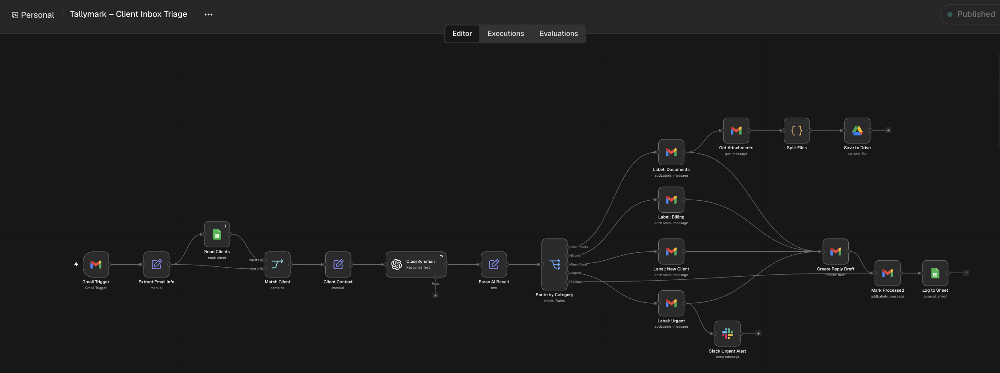
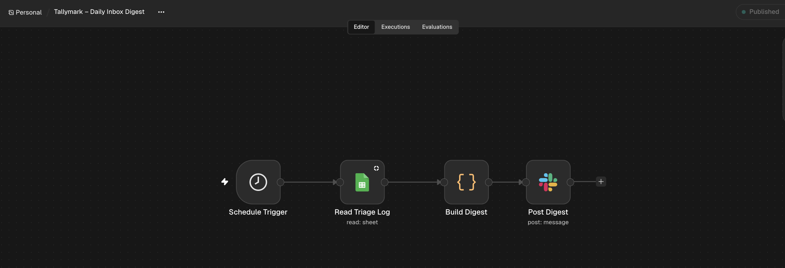
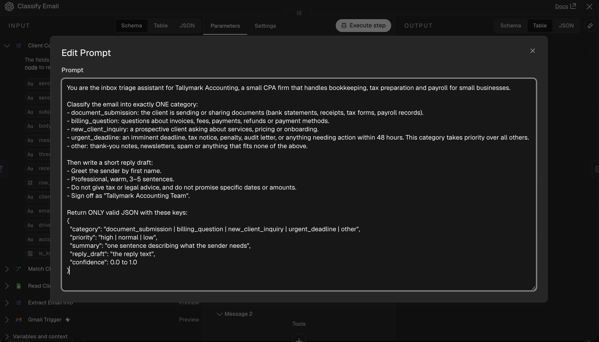
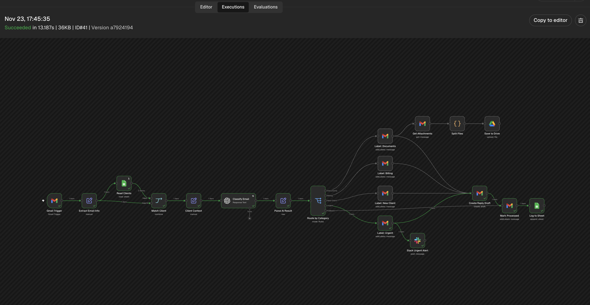
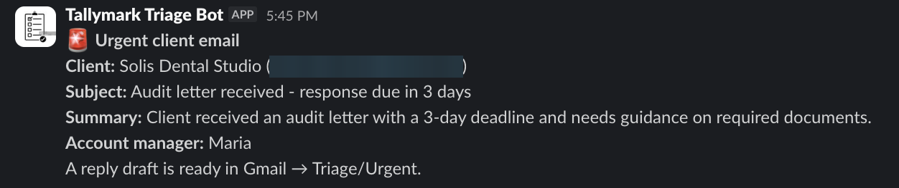
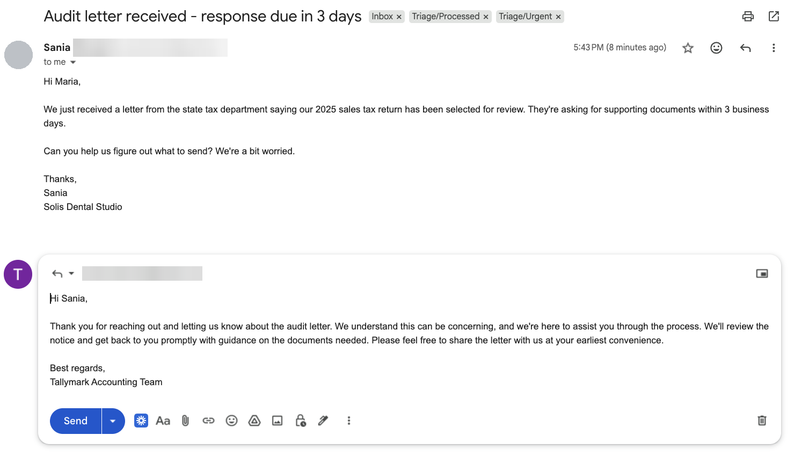
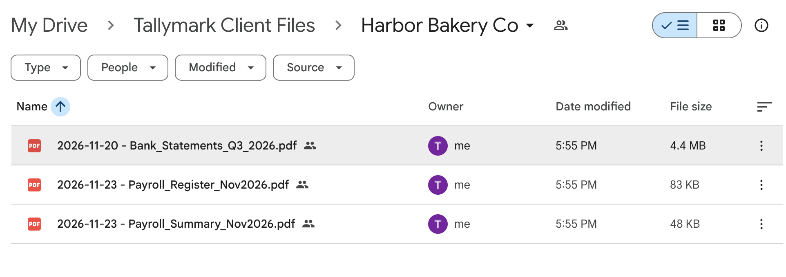
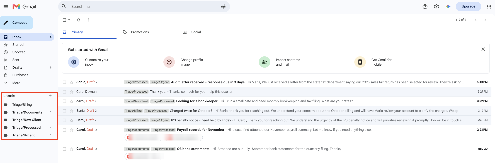
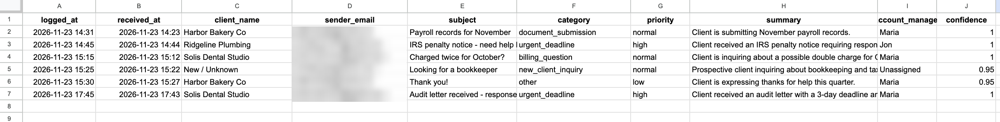
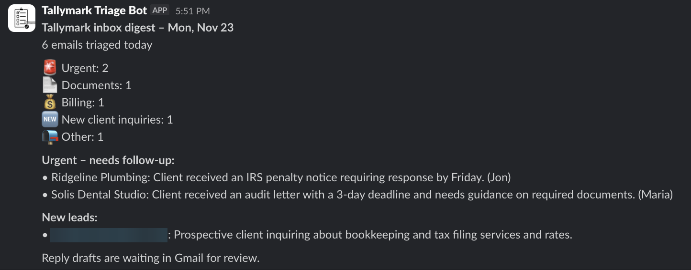

# Tallymark: Client Inbox Triage

A self-hosted n8n automation that reads every client email for **Tallymark Accounting**, a fictional small CPA firm, and acts on it within minutes. GPT sorts each email into documents, billing, new client, urgent or other. Attachments are saved to the right client folder in Google Drive, reply drafts land in the client's Gmail thread for review, urgent issues trigger an instant Slack alert, and the team gets a daily Slack digest. Every email is logged.

**▶ [Watch the demo on Loom](https://www.loom.com/share/169920fd465845d89588fdb5b5e4658b)**

| | |
| --- | --- |
| **Platform** | n8n, self-hosted in Docker, with OpenAI (GPT) |
| **Apps connected** | Gmail, Google Drive, Google Sheets, Slack, OpenAI |
| **Workflow size** | 3 workflows: a 21-node triage flow with 5 branches, a 4-node daily digest and an error alert |
| **Live test** | 7 of 7 emails classified and routed correctly |

> Tallymark Accounting is a fictional company. All clients, emails and files are test data.

---

## The problem

Tallymark handles bookkeeping, tax preparation and payroll for small businesses. All client communication arrives in one shared inbox, which caused four problems:

- **Manual filing.** Clients email bank statements, payroll records and tax forms. Someone had to download each attachment and file it in the right client folder by hand.
- **Buried deadlines.** A tax penalty notice or an audit letter with a 3-day deadline looks like any other email in a busy inbox.
- **Slow first replies.** Billing questions and new-client inquiries waited until someone had time to write a response, and prospects can go elsewhere.
- **Confidential data.** The emails contain client financial information, so routing them through a third-party automation platform is a real concern for the firm.

## The solution

The workflow runs on n8n in Docker on infrastructure the firm controls. Every 5 minutes it checks the inbox and takes it from there:

1. **Trigger:** Gmail picks up any email that doesn't have the *Triage/Processed* label yet.
2. **Identify the client:** the sender is matched against a *Client Directory* sheet to find the client name, Drive folder and account manager. Unknown senders get *New / Unknown* and an `_Unsorted` folder instead of stopping the flow.
3. **Classify:** GPT reads the email plus the client context and returns a category, priority, one-line summary, reply draft and confidence score as JSON.
4. **Route:** a Switch node splits the flow into five paths.

**Documents**
- Applies the *Triage/Documents* label.
- Downloads the attachments and saves each one to the client's Drive folder, named with the date it arrived (for example `2026-11-23 - Payroll_Summary_Nov2026.pdf`).

**Billing and New client**
- Applies the matching label. New-client inquiries are also listed as leads in the daily digest.

**Urgent**
- Applies the *Triage/Urgent* label and posts an instant Slack alert to `#tallymark-inbox` with the client, subject, AI summary and account manager.

**Other**
- Thank-you notes and newsletters are marked as processed with no draft.

Every path except Other then creates a reply draft inside the client's original email thread. Every email is marked *Triage/Processed* and logged to a *Triage Log* sheet.

**Two supporting workflows** run alongside it. A daily digest posts a 5 PM summary to Slack with counts by category, urgent follow-ups with the responsible account manager, and new leads. An error workflow posts any failure to Slack with the workflow, node and error message.

**The classification prompt** uses a fixed system message for the rules and a user message with the email and client context. Temperature is 0.2 for consistent results. Full text: [`templates/classifier-prompt.md`](templates/classifier-prompt.md).

## Key design decisions

| Decision | Why it matters |
| --- | --- |
| Self-host n8n in Docker | Accounting data is confidential. The workflow logic, credentials and execution logs stay on infrastructure the firm controls. Only the classification step sends email text out, and it can be swapped for a local model. |
| Draft replies, never auto-send | An accountant reviews every reply. Drafts are created inside the original thread, so the suggested reply is right there when the email is opened. |
| Urgent overrides every other category | An email can contain documents and mention a penalty notice. A missed deadline costs the firm far more than a misfiled receipt. |
| Give the AI client context, not just the email | GPT knows the client name, whether the sender is a known client and their account manager. Drafts can say "Maria will review your account", and prospects are recognised as leads. |
| Match senders with a left join | Unknown senders keep going with safe defaults (*New / Unknown*, *Unassigned*, `_Unsorted` folder) instead of dropping out of the flow. |
| *Processed* label plus a trigger filter | The trigger skips anything already labelled, so restarts and re-runs never create duplicate drafts or uploads. |
| Handle attachments on their own path | An email with two files creates two uploads but one draft. An email that says "attached" but has no file still gets its label and reply. |
| Read every field from one combined node | Each Gmail node replaces the data with Gmail's response. Later steps read from the *Parse AI Result* node, which always holds the email, client and AI fields together. |
| Guardrails in the prompt | No tax or legal advice and no promised dates or amounts, so a draft is safe to send after a quick review. |
| Run the digest as a separate workflow | It reads from the log on a schedule. If reporting breaks, email triage keeps running. |
| Error alerts and automatic retries | Failures post to Slack instead of emails quietly piling up. The AI step retries on temporary API errors. |

## Results

All seven test emails were classified and routed correctly, covering every category and both known and unknown senders. Once the workflow was live, emails were processed automatically within the 5-minute poll: the billing email arrived at 3:12 PM and was handled at 3:15 PM.

| Email | Client | Category | Confidence | What happened |
| --- | --- | --- | --- | --- |
| Q3 bank statements (1 PDF) | Harbor Bakery Co | Documents | 1.0 | File saved to client folder, reply draft |
| Payroll records (2 PDFs) | Harbor Bakery Co | Documents | 1.0 | Both files saved, one reply draft |
| IRS penalty notice | Ridgeline Plumbing | Urgent | 1.0 | Slack alert naming Jon, reply draft |
| Charged twice for October | Solis Dental Studio | Billing | 1.0 | Reply draft mentioning Maria |
| Looking for a bookkeeper | Unknown sender | New client | 0.95 | Logged as *New / Unknown*, listed as a lead |
| Thank you! | Harbor Bakery Co | Other | 0.95 | Marked processed, no draft |
| Audit letter, 3-day deadline | Solis Dental Studio | Urgent | 1.0 | Slack alert naming Maria, reply draft |

**A live run of an urgent email**

The path splits into the Slack alert and the reply draft, then joins again to mark the email processed and log it. The other branches were skipped.

**Instant Slack alert** (sender email blurred)

**Reply draft waiting in the client's thread** (sender details blurred)

It reassures a worried client without giving tax advice or promising a date.

**Attachments filed into the client's folder**

**Inbox after the test** (attachment names blurred)

Every email is labelled by category, with a draft waiting.

**Triage Log** (email column blurred)

**5 PM daily digest** (lead email blurred)

## What I learned

- **Input order matters when joining data.** My first Merge returned the three clients instead of the email, because the client list was wired into the input I was enriching. Checking the item count after every join catches this immediately.
- **Testing one step is not testing the workflow.** Running a single node only runs the path leading to it, so a whole branch looked broken when it had simply been skipped. A full run with a fresh email is the only real test.
- **Duplicate protection can look like a failure.** A re-run that did nothing was the filter working: the email was already processed. A fresh test email is needed each time.
- **Self-hosting means owning the infrastructure.** Docker stopped mid-project because the laptop's disk was full. In production, disk space and uptime need monitoring, which is why the error alert exists.

## What I'd add next

- Send emails classified below 0.7 confidence to a *Needs review* label instead of trusting the category.
- Move to a small cloud server with HTTPS and publish the Google OAuth app, so sign-ins don't expire every 7 days.
- Swap the GPT step for a local model through Ollama, so no email content leaves the server.
- Add a direct link to the Gmail thread in each Slack alert.
- Sync the client directory from the firm's practice management system instead of a sheet.

## Why this matters for healthcare

The same pattern fits a clinic or health tech company: one inbox receiving referrals, lab results, insurance questions, new-patient inquiries and urgent clinical messages. Self-hosting, drafts instead of auto-sending, an audit log and the option to run the AI step on a local model are the controls that matter when handling protected health information under rules such as HIPAA.

## Rebuild it yourself

The [`workflows`](workflows/) folder has the three n8n workflow exports, and [`templates`](templates/) has everything else:

- [`classifier-prompt.md`](templates/classifier-prompt.md): the system and user prompts, and why they're written that way
- [`client-directory.csv`](templates/client-directory.csv): the client directory layout with fictional clients
- [`test-data.md`](templates/test-data.md): the seven test emails and the expected result for each

1. Run n8n with Docker: `docker run -d --name n8n --restart unless-stopped -p 5678:5678 -v n8n_data:/home/node/.n8n docker.n8n.io/n8nio/n8n`
2. In Gmail, create the labels `Triage/Documents`, `Triage/Billing`, `Triage/New Client`, `Triage/Urgent` and `Triage/Processed`.
3. In Google Drive, create a folder per client plus an `_Unsorted` folder. Create a *Client Directory* sheet using `client-directory.csv` and a *Triage Log* sheet with these columns: `logged_at | received_at | client_name | sender_email | subject | category | priority | summary | account_manager | confidence`
4. Create the Slack channel `#tallymark-inbox` and a Slack app with the `chat:write` scope, then invite the bot to the channel.
5. In n8n, add credentials for Gmail, Google Drive and Google Sheets (OAuth), OpenAI and Slack. No credentials are included in the exports.
6. Import the workflows (**⋯ → Import from File**), select your credentials in each node and replace the placeholders (including the Gmail label IDs) listed in [`workflows/README.md`](workflows/README.md).
7. Set the error workflow in each workflow's settings, publish all three, and send the test emails from `test-data.md`.

---

*Portfolio project. Tallymark Accounting is a fictional company, and all client data shown is test data.*
